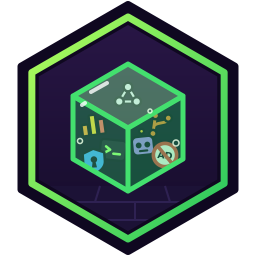

<p align="center">
  
</p>

<h1 align="center">gelkube</h1>

<p align="center">
  <em>A one-laptop Kubernetes homelab. Like a gelatinous cube, it absorbs everything in its path.</em>
</p>

<p align="center">
  
  
  
  
  
  
  
  
  
  
  
  
  
</p>

---

## What is this?

**gelkube** is my homelab and build log. I'm learning Kubernetes by building a homelab on an old laptop in Denver, inspired by what I saw at **KubeCon + CloudNativeCon North America 2026**.

The name comes from the **gelatinous cube** 🟩, the D&D monster that's a giant translucent cube and slowly absorbs everything in its path, including adventurers, swords and gold. Kubernetes is a cube too, and this lab is going to absorb a lot of services. The server's hostname is `gelkube`.

The logo shows the cube with the lab's tools floating inside it: 🖥️ the Linux server, 📊 monitoring, 🔀 GitOps, 🛡️ the password manager, 🚫 ad blocking, 🤖 AI agents, and 🔺 the Tailscale VPN mesh on top.

I'm documenting every step so I can look back on what I did, and so others can follow along or learn from my mistakes.

## Goals

- **Learn Kubernetes from the ground up:** the control plane, pod networking, and GitOps
- **Self-host useful services:** network-wide ad blocking and my own password manager
- **Reach everything privately from anywhere** with Tailscale, with nothing exposed to the internet
- **Experiment with cloud-native AI agent tooling** from KubeCon
- **Build a physical status display** with the ESP32 I got at KubeCon
- **Document everything** as I go

## Hardware

| Device | Specs | Role |
|---|---|---|
| Lenovo Yoga laptop (Intel Raptor Lake) | 16GB RAM, 1TB Samsung NVMe SSD | The whole lab: host for VMs and the cluster |
| ESP32-2432S028 "Cheap Yellow Display" (KubeCon swag) | 2.8" 320×240 touchscreen, Wi-Fi | Lab status display |

## Technologies

Status: ⏳ planned · 🚧 in progress · ✅ running · 🧪 experiment · 📚 reading only

### Foundation
| Tech | What it does here | Phase | Status |
|---|---|---|---|
| [Ubuntu Server 26.04.1 LTS](https://ubuntu.com/server) | Host operating system | 0 | ✅ |
| [OpenSSH](https://www.openssh.com/) | Remote access to the server | 0 | ✅ |
| [Tailscale](https://tailscale.com/) | Private VPN mesh, so I can reach the lab from anywhere | 0 | ✅ |
| [KVM / libvirt](https://libvirt.org/) | Runs the VMs for Kubernetes the Hard Way | 1 | ✅ |

### Kubernetes the Hard Way (learning cluster)
| Tech | What it does here | Phase | Status |
|---|---|---|---|
| [Kubernetes the Hard Way](https://github.com/kelseyhightower/kubernetes-the-hard-way) | Guide for building a cluster by hand: jumpbox, server, node-0, node-1 | 1 | ✅ |
| [etcd](https://etcd.io/) | Stores all cluster state | 1 | ✅ |
| kube-apiserver, kube-scheduler, kube-controller-manager | The control plane | 1 | ✅ |
| kubelet, kube-proxy | Run on each worker node | 1 | ✅ |
| [containerd](https://containerd.io/) | Container runtime | 1 | ✅ |
| [CNI plugins](https://www.cni.dev/) | Pod networking (bridge plus host-local IPAM) | 1 | ✅ |

### Main cluster and GitOps
| Tech | What it does here | Phase | Status |
|---|---|---|---|
| [k3s](https://k3s.io/) | Lightweight Kubernetes for the main cluster | 2 | ⏳ |
| [kubectl](https://kubernetes.io/docs/reference/kubectl/) + [k9s](https://k9scli.io/) | Cluster CLI and terminal UI | 2 | ⏳ |
| [Helm](https://helm.sh/) | Installs apps on the cluster | 2 | ⏳ |
| [Argo CD](https://argo-cd.readthedocs.io/) | GitOps: syncs the cluster from this repo | 2 | ⏳ |
| [Flux](https://fluxcd.io/) | GitOps alternative, to try on a throwaway cluster | stretch | 🧪 |
| [Cilium](https://cilium.io/) + Hubble | eBPF networking, and lets me watch packets between pods | stretch | 🧪 |

### Services
| Tech | What it does here | Phase | Status |
|---|---|---|---|
| [Tailscale Kubernetes operator](https://tailscale.com/kb/1236/kubernetes-operator) | Gives apps private HTTPS URLs on my tailnet | 3 | ⏳ |
| [AdGuard Home](https://github.com/AdguardTeam/AdGuardHome) | Network-wide ad blocking, used as my tailnet's DNS | 3 | ⏳ |
| [Sealed Secrets](https://github.com/bitnami-labs/sealed-secrets) | Lets encrypted secrets live safely in Git | 3 | ⏳ |
| [Vaultwarden](https://github.com/dani-garcia/vaultwarden) | Password manager that works with the Bitwarden apps | 3 | ⏳ |

### Observability
| Tech | What it does here | Phase | Status |
|---|---|---|---|
| [Prometheus](https://prometheus.io/) | Collects metrics | 4 | ⏳ |
| [Grafana](https://grafana.com/) | Dashboards | 4 | ⏳ |
| [OpenTelemetry Collector](https://opentelemetry.io/) | Collects traces from apps and agents | 4 | ⏳ |
| [Uptime Kuma](https://github.com/louislam/uptime-kuma) | Checks whether my services are up | 4 | ⏳ |

### AI agents
| Tech | What it does here | Phase | Status |
|---|---|---|---|
| [kagent](https://kagent.dev/) | Runs AI agents as Kubernetes resources | 5 | ⏳ |
| [Agent Sandbox](https://github.com/kubernetes-sigs/agent-sandbox) | `Sandbox` resource for running agents in isolation (SIG Apps) | 5 | ⏳ |
| [gVisor](https://gvisor.dev/) / [Kata Containers](https://katacontainers.io/) | Stronger isolation for sandboxes | 5 | ⏳ |
| [OpenShell](https://github.com/NVIDIA/OpenShell) | Enforces policies on what an agent can reach | 5 | 🧪 |
| Agent Substrate | Runs very large numbers of agents on a few pods | — | 📚 |

### Hardware projects
| Tech | What it does here | Phase | Status |
|---|---|---|---|
| ESP32-2432S028 + [LovyanGFX](https://github.com/lovyan03/LovyanGFX) | [gelkube-dash](esp32/gelkube-dash/): cube mascot, live map with traffic dots, health stats ([gelcube-buddy](esp32/gelcube-buddy/) is the mascot on its own) | 6 | 🚧 |
| [gelkube-status](host/status-exporter/) (Python) | Serves the lab's health as JSON for the ESP32 | 6 | 🚧 |

## Roadmap

- [x] **Phase 0: Base server.** Ubuntu Server, SSH keys and Tailscale ✅
- [ ] **Phase 1: Kubernetes the Hard Way.** Build a cluster by hand on 4 VMs, then break and fix the networking (✅ cluster built, smoke tests pass, survives reboot · 🚧 break-it exercises)
- [ ] **Phase 2: Main cluster.** k3s, Argo CD and Helm, with everything deployed from this repo
- [ ] **Phase 3: Services.** Tailscale operator, AdGuard Home, Sealed Secrets, Vaultwarden and backups
- [ ] **Phase 4: Observability.** Prometheus, Grafana, OpenTelemetry and Uptime Kuma
- [ ] **Phase 5: AI agents.** kagent, Agent Sandbox and OpenShell
- [ ] **Phase 6: ESP32 status display**
- [ ] **Stretch goals:** swap in Cilium, try Flux, and contribute to a Kubernetes SIG

## Build log

| # | Entry | Status |
|---|---|---|
| 01 | [Planning: goals, name and technology choices](docs/01-planning.md) | ✅ Done |
| 02 | [Installing Ubuntu Server on the laptop](docs/02-installing-ubuntu.md) | ✅ Done |
| 03 | [Kubernetes the Hard Way](docs/03-kubernetes-the-hard-way.md) | ✅ Cluster built |
| — | [KubeCon NA 2026 notes](docs/kubecon-2026-notes.md) | 📓 Reference |

## How I document

Every step gets its own numbered file in `docs/`, based on [`docs/_template.md`](docs/_template.md). Inside each entry, every step follows the same pattern: **Why**, **Commands**, **What it does** and **What happened**. Each entry also has:

1. **Goal:** what I'm trying to do and why
2. **Steps:** a checklist with the exact commands I ran
3. **What broke:** errors I hit and how I fixed them (the most useful part!)
4. **What I learned**
5. **Next up**

Some ground rules:

- **Write it down while doing it, not after.** Copy commands and error messages as they happen.
- **Screenshots and photos** go in `assets/screenshots/`.
- **Never commit secrets.** This repo is public. No passwords, tokens, auth keys, kubeconfigs or private keys. Real secrets go in Sealed Secrets once that's set up, and `.gitignore` blocks the obvious ones.
- **Update this README** when a phase or technology changes status.

## Repo layout

```
gelkube-labs/
├── README.md            ← you are here
├── assets/              ← logo and screenshots
└── docs/                ← build log, one file per step
    └── _template.md     ← copy this for each new entry
```

Later on, this repo will also hold the Kubernetes manifests that Argo CD deploys (for example `clusters/` and `apps/`).
